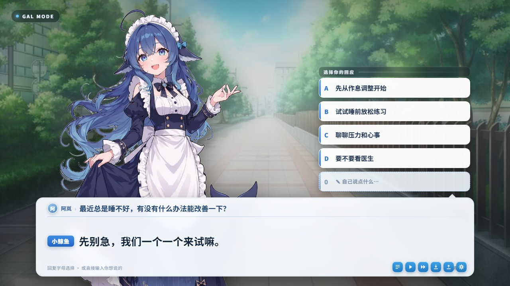
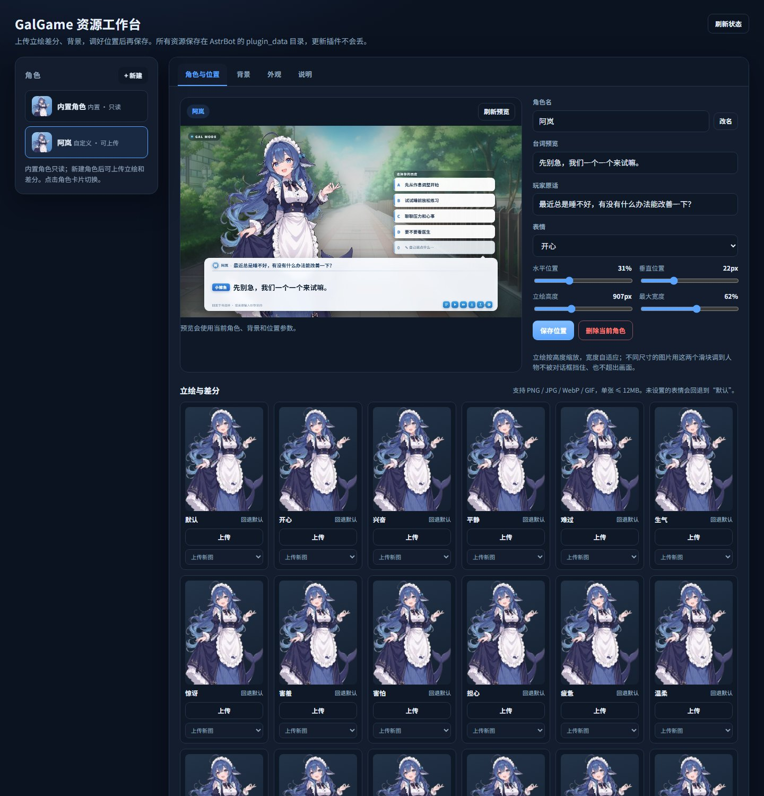

# GalGame 选项

把 AstrBot 的回答变成一张 GalGame 界面图：角色立绘、打字机式对话框、A/B/C/D 选项，还有一条角色语音。

> 进入 gal 模式后，模型每轮只输出「表情 + 台词 + 2~4 个选项」，插件负责渲染和接住玩家的选择；
> 选项会带进下一轮，形成连续剧情。没有想选的可以回 `0`，或者直接说自己的话。





## 功能

- **WebUI 资源工作台**：在插件详情页打开可视化视图，上传角色立绘/表情差分、背景，拖动滑块调位置、高度、宽度，实时预览后保存。
- **多角色档案**：内置鲸鱼娘只读；新建角色后可上传自己的默认立绘和 18 类情绪差分，随时切换。
- **情绪共用**：支持 FishAudio 的 49 个情绪标签，自动归到 18 个视觉组；同一张立绘可以在 WebUI 里共用给多个情绪，不用每个情绪都画一张。
- **背景库**：内置背景 + 自定义背景；可跟随会话、随机，或固定一张。
- **一键进入 gal 模式**：`/gal start`，或直接说“gal”。
- **选项成图**：1280×720，角色立绘按表情切换，对话框显示玩家的原话和角色台词。
- **三种选择方式**：回字母 `A/B/C/D`、回数字 `1/2/3/4`、回选项原文；也支持 `0` 或直接说话自由输入。
- **连续剧情**：选择会写进下一轮 prompt，插件同时保存最近几幕的选择摘要，上下文被裁剪也能接上。
- **TTS 配音**：图片发出后，把台词交给 AstrBot 的 TTS 提供商念出来；FishAudio 会自动加情绪标签，QQ 侧预转 SILK 兼容 NapCat。
- **会话级模型**：`/gal model <provider_id>` 指定 gal 模式用哪个模型，退出时恢复原模型。
- **背景连续**：默认一个会话固定一张背景，不会每轮跳来跳去；可切换为随机或固定。
- **失败可降级**：模型没按格式输出或 T2I 出图失败时，发可读的文字选项，不会把 `<say><opt>` 原样吐给玩家。
- **数据安全**：状态放在 `data/plugin_data/`，带 TTL、原子写和并发锁；不会因为更新插件丢档。

## 环境要求

- AstrBot `>=4.21,<5`
- 一个可用的 **文转图（T2I）** 服务：AstrBot 自带的 Playwright 渲染，或远程 T2I 服务
- 一个可用的 **TTS** 提供商（可选，但强烈推荐 FishAudio）
- QQ 语音需要 **`silk-python`**（`requirements.txt` 已声明，市场安装会自动装）和 **ffmpeg**；插件会把 WAV/MP3 预转成 Tencent SILK，绕开 NapCat 自带 ffmpeg 缺少 `ntsilk_s16le` 编码器的问题
- 消息平台：**QQ 个人号（aiocqhttp / NapCat）**。本版本只声明支持 `aiocqhttp`

## 安装

### 插件市场

在 AstrBot WebUI 的「插件」页搜索 **GalGame 选项** 安装。

### 手动安装

```bash
cd AstrBot/data/plugins
git clone https://github.com/ggxiaobailong-blip/astrbot_plugin_gal_choice.git
pip install -r astrbot_plugin_gal_choice/requirements.txt
```

重启 AstrBot 或重载插件。市场安装会自动处理 `requirements.txt`。

## 使用

```text
/gal                进入 GalGame 模式（也可以直接说“gal”）
/gal start          进入 GalGame 模式
/gal stop           退出
/gal status         查看当前模式、选项、幕数、模型、语音状态
/gal model <id>     指定 gal 模式使用的模型；default 恢复跟随会话
/gal voice on|off   开关本会话语音
/gal reset          清空本会话状态
/gal help           查看帮助
```

进入模式后：

1. 发一句话，或直接说“开始”，模型会给出第一张图和选项。
2. 回 `A` / `B` / `C` / `D`（或 `1` / `2` / `3` / `4`）选择。
3. 没有想选的，回 `0`，或者直接说你想说的话。
4. 想退出，说“退出gal模式”或发 `/gal stop`。

## 自定义立绘 / 背景

在 AstrBot WebUI 的插件详情页打开 **「GalGame 资源工作台」**：

- **角色**：新建角色 → 上传「默认」立绘 → 给 18 类情绪上传差分；没有单独画的情绪会自动回退默认。
- **共用**：某个情绪卡片的下拉框可以选一张已经上传的立绘，让多个情绪共用同一张图。
- **位置**：拖「水平位置 / 垂直位置 / 立绘高度 / 最大宽度」四个滑块，让头肩在画面里、下半身被对话框挡住；保存后下一轮立即生效。
- **背景**：上传自己的背景，点选固定；也可以保留“跟随背景模式”。
- **外观**：角色名标签、自由输入位文案、对话框透明度、出图质量。

资源保存到：

```text
data/plugin_data/astrbot_plugin_gal_choice/
├── characters.json
└── assets/
    ├── characters/<角色 id>/
    └── backgrounds/
```

更新/重装插件不会清空这个目录。内置角色只读；位置仍然可以调。

> WebUI 视图依赖 AstrBot 的插件页面能力（4.29.x 已实测）。旧版本仍可正常出图，但没有可视化工作台，可以手动编辑 `characters.json` 和 `assets/`。

## 情绪与差分

模型可以写 18 个中文视觉组，也可以直接写 FishAudio 的英文情绪标签（例如 `<emo>sarcastic</emo>`）。插件会把标签归到最接近的视觉组来选立绘，但 TTS 仍使用你写的具体标签。

| 视觉组 | 代表标签 | 同组可共用的标签 |
| --- | --- | --- |
| 开心 | `happy` | satisfied, delighted, optimistic |
| 兴奋 | `excited` | excited |
| 平静 | `calm` | relaxed |
| 难过 | `sad` | unhappy, depressed, disappointed, regretful, pessimistic, lonely |
| 生气 | `angry` | upset, frustrated |
| 惊讶 | `surprised` | surprised |
| 害羞 | `embarrassed` | guilty, ashamed |
| 害怕 | `scared` | hysterical |
| 担心 | `worried` | nervous, anxious, uncertain |
| 疲惫 | `resigned` | tired（别名） |
| 温柔 | `compassionate` | empathetic, sympathetic, grateful |
| 得意 | `proud` | confident, determined |
| 困惑 | `confused` | doubtful |
| 无语 | `indifferent` | bored |
| 坏笑 | `sarcastic` | jealous, envious |
| 感动 | `moved` | hopeful, nostalgic |
| 厌恶 | `disgusted` | disdainful, contemptuous |
| 好奇 | `curious` | curious |

完整标签列表见 [FishAudio Emotion Control](https://docs.fish.audio/developer-guide/core-features/emotions)。在 WebUI 里，每个情绪卡片都有「上传新图」下拉：选择已上传的图，就能让多个情绪共用一张立绘。

> 群里第一次进入：直接说“进入gal模式”或发 `/gal start` 都可以（如果平台/其他插件拦住了未 @ 的消息，先 @ 机器人）。
> 进入模式后，裸字母会自动唤醒，不用每轮都 @。

## 配置

配置文件在 `data/config/astrbot_plugin_gal_choice_config.json`，也可以在 WebUI 插件配置里改。

| 配置项 | 类型 | 默认 | 说明 |
|---|---|---|---|
| `mode_on_words` | string | `进入gal模式,gal模式,切换gal模式,开始gal` | 进入模式的说法，整条消息完全一致才触发 |
| `mode_off_words` | string | `退出gal模式,退出gal,结束gal,退出游戏,关闭gal` | 退出模式的说法，整条消息完全一致才触发 |
| `mode_idle_minutes` | int | `120` | 无互动自动退出模式的分钟数 |
| `option_ttl` | int | `600` | 选项有效秒数 |
| `bot_label` | string | `小鲸鱼` | 台词框前的名字标签 |
| `default_say` | string | `这几个方向，你想先聊哪个？` | 台词为空时的兜底 |
| `say_max_units` | float | `46` | 台词字数上限（中文算 1，半角约 0.55） |
| `option_max_units` | float | `16` | 选项字数上限 |
| `free_option_hint` | string | `✎ 自己说点什么…` | 自由输入位文案，字母位固定为 0 |
| `free_input_enabled` | bool | `true` | 是否显示自由输入位 |
| `emotion_default_file` | string | `whale_girl_moe.webp` | 默认立绘 |
| `emotion_map` | dict | 见默认配置 | 表情 → 立绘文件 |
| `background_file` | string | 空 | 固定背景文件名 |
| `background_mode` | string | `session` | `session` / `random` / `fixed` |
| `background_blur` | int | `20` | 背景模糊 px |
| `box_alpha` | float | `0.94` | 对话框不透明度 |
| `show_icons` | bool | `true` | 右下角装饰图标 |
| `show_turn_label` | bool | `true` | 右下角“序章 / 第 N 幕” |
| `say_font_size` | int | `26` | 台词基准字号 |
| `image_quality` | int | `90` | 出图 JPEG 质量 |
| `render_endpoint` | string | `""` | 首选文转图端点，多个用逗号分隔；留空用 AstrBot 全局 T2I，失败会自动尝试端点池 |
| `voice_enabled` | bool | `true` | 台词配音总开关 |
| `voice_probability` | float | `1.0` | 每条台词配音概率 |
| `tts_provider_id` | string | 空 | 指定 TTS 提供商；留空用当前会话 |
| `tts_emotion_mode` | string | `auto` | `auto` / `fishaudio` / `off` |
| `gal_provider_id` | string | 空 | gal 模式固定模型；留空跟随会话。指定后会临时切换本会话 provider，退出/停用插件时恢复原模型 |
| `avatar_enabled` | bool | `true` | 是否显示提问者头像 |
| `avatar_size` | int | `100` | QQ 头像请求尺寸 |

## 工作原理

```text
用户消息
  └─ gal_gate：会话在 gal 模式 → 打开 is_at_or_wake_command（群聊裸字母也能触发 LLM）
      └─ inject_choice：把“玩家选了 X”+ 输出格式写进 system prompt
          └─ 模型输出 <emo>/<say>/<opt>
              └─ decorate_result：解析 → Jinja2 模板 → html_render 出图
                  └─ 图片发送后 after_message_sent → TTS 语音
```

- 模板在 `templates/gal.html`，所有用户文本都通过 Jinja2 的 `data` 传入并用 `|e` 转义，不拼进模板源码。
- gal 模式会关闭本轮流式输出，等模型给出完整台词和选项后再出图；退出模式后恢复 AstrBot 的流式设置。
- gal 模式会临时关闭本轮的工具调用，避免模型在出图前插入工具状态文字；退出模式后工具恢复。
- 状态在 `data/plugin_data/astrbot_plugin_gal_choice/sessions.json`，原子写（临时文件 + `os.replace`）。
- 出图失败、选项不足 2 个、T2I 不可用时，统一降级成可读文字。

## 常见问题

**Q：群里回 A 没反应？**  
A：确认已经进入 gal 模式；第一次进入需要 @ 机器人或发 `/gal start`。进入后插件会显式设置 `is_at_or_wake_command`，裸字母也能触发。

**Q：图片没生成，发了一段文字？**  
A：说明 T2I 渲染失败或模型没给出 2 个以上选项。插件会发可读的文字选项，不会泄露 `<say>` 标签。检查 AstrBot 的文转图服务。

**Q：预览/出图一直转圈或超时？**  
A：AstrBot 的官方 T2I 端点池里偶尔会有端点返回 502/503 或上传大图很慢。插件会先试「外观 → 文转图端点」里配置的端点，再自动切换 AstrBot 端点池并重试；全部失败才会报错。可以填一个或多个可用地址（逗号分隔），例如 `https://t2i.soulter.top/text2img,https://t2i.rcfortress.site/text2img`。单次渲染有超时，不会无限等。

**Q：没有语音？**  
A：检查 AstrBot 的 TTS 是否启用、是否配置了提供商；`/gal voice` 看会话开关；FishAudio 之外提供商会自动去掉情绪标签。QQ 语音需要 `silk-python` 和 `ffmpeg`，插件会先转成 SILK 再发；如果日志出现 `ntsilk_s16le`，说明 NapCat 仍在尝试自己转码，通常是没有装依赖或插件版本过旧。

**Q：模型老是不按 `<say><opt>` 输出？**  
A：插件会尝试解析编号列表和代码块；仍失败就降级文字。建议用指令遵循较好的模型，或把 `/gal model` 指到更稳的模型。

**Q：能换角色/背景吗？**  
A：把立绘放进 `assets/`，在 `emotion_map` 里配置表情→文件；背景放进 `background/`，用 `background_file` 或 `background_mode` 选择。

## 隐私

- 头像通过 `q1.qlogo.cn` 获取提问者 QQ 头像；可在配置里关闭 `avatar_enabled`，关闭后显示昵称首字占位。
- 台词文本会发送给你配置的 TTS 提供商（如 FishAudio）。
- 会话状态只保存在本机 `data/plugin_data/astrbot_plugin_gal_choice/`，包含 QQ 号、会话 key、最近选项和选择摘要；`mode_idle_minutes` 到期会自动清理。
- 插件不发送遥测，不访问除头像/T2I/TTS 之外的网络。

## 兼容性

- 只声明支持 `aiocqhttp`（QQ 个人号 / NapCat）。语音依赖 OneBot 的 `Record`，头像依赖 QQ 头像接口。
- 其他平台理论上能出图，但语音、头像、`Record` 行为未验证，因此不在 `support_platforms` 里声明。
- 依赖 AstrBot 的 `html_render`、`on_llm_request`、`on_decorating_result`、`after_message_sent`、`ProviderManager.set_provider`，范围 `>=4.21,<5`；已在 **4.29.3** 实测。

## 开发

```bash
python -m unittest discover -s tests -t .
```

测试覆盖解析、选项匹配、状态 TTL/持久化、模板数据和路径穿越校验。

## 致谢与许可

- 本插件基于 [bvzrays/astrbot_plugin_qqgal](https://github.com/bvzrays/astrbot_plugin_qqgal) 修改，原项目为 **AGPL-3.0**。
- 立绘为 DeepSeek 娘二创形象；背景素材沿用上游插件；主界面 UI 为本项目重新绘制。
- 修改日期与修改说明见 [`NOTICE`](NOTICE)。

本项目按 **GNU Affero General Public License v3.0** 发布，见 [`LICENSE`](LICENSE)。由于上游是 AGPL-3.0，本插件也必须保持 AGPL-3.0 并公开源码；分发时请保留 `NOTICE` 和 `LICENSE`。
